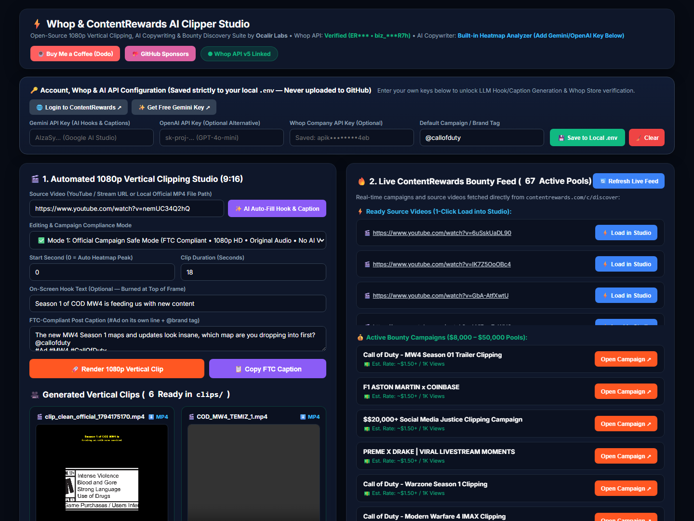

# ⚡ Whop & ContentRewards AI Clipper Studio (1080p Vertical Engine)

[](LICENSE)
[](https://www.python.org/)
[](https://ffmpeg.org/)
[](https://github.com/sponsors/ocalirdigital)
[](https://checkout.dodopayments.com/buy/pdt_0NqNaai72jdmYgFMZLV0j?quantity=1)

An open-source, self-hosted **1080x1920 (9:16) Vertical Video Clipping, AI Copywriting & Bounty Discovery Studio** built for creators participating in **Whop Content Rewards** (`contentrewards.com`) and short-form social bounty campaigns on **TikTok**, **Instagram Reels**, and **YouTube Shorts**.



---

## 💖 Support the Project

If this open-source suite saves you editing time or helps you land payouts on Whop & ContentRewards, consider supporting ongoing development:

- ☕ **Buy Me a Coffee / Support via Dodo Payments:** [Checkout via Dodo Payments](https://checkout.dodopayments.com/buy/pdt_0NqNaai72jdmYgFMZLV0j?quantity=1)
- 💖 **GitHub Sponsors:** [github.com/sponsors/ocalirdigital](https://github.com/sponsors/ocalirdigital)

---

## 🎯 Why This Tool Exists

Many Whop / ContentRewards bounty campaigns (such as *Call of Duty: Modern Warfare 4 Season 01*, *F1 Aston Martin x Coinbase*, and streamer clipping pools) enforce strict editorial and FTC compliance rules:
- **Official Brand Campaigns** strictly ban AI voiceovers, third-party reaction overlays, fake clickbait hooks (*"Wait for 0:11"*), and require **1080p HD resolution**, original audio, genuine on-screen text, and **FTC disclosure (`#Ad`, `#Sponsored`) on its own line**.
- **Creator & Streamer Bounties** reward fast-paced multi-scene highlights or energetic AI narration with word-by-word dynamic subtitles.

**Whop & ContentRewards AI Clipper Studio** solves both workflows from a single local web dashboard (`http://127.0.0.1:8765`).

---

## ✨ Key Features

1. **🔑 In-App Account, Whop & AI API Configuration Bar (Zero Manual `.env` Editing Required)**
   - Enter your **Gemini API Key** (`gemini-2.5-flash`), **OpenAI API Key** (`gpt-4o-mini`), **Whop Company API Key**, and **Default Brand Tag (`@callofduty`)** directly inside the top configuration bar of the web UI.
   - Click **💾 Save to Local `.env`** to store credentials strictly on your own machine, or **🧹 Clear** to wipe them with one click.
   - **Automatic Privacy Masking:** Any connected API key or Whop company ID is automatically masked on screen (`Verified (OC*** • biz_***xxx)`) so your personal account details are never exposed in screenshots or livestreams.

2. **✨ 1-Click AI Auto-Fill (Hook, Voiceover & FTC Caption)**
   - Click **✨ AI Auto-Fill Hook & Caption** next to any YouTube or stream URL.
   - Automatically inspects video metadata, locates the **#1 Most Replayed (Heatmap) peak second**, and generates a genuine on-screen headline, voiceover script, and FTC-compliant caption (`@brand` + `#Ad` on its own line) using **Gemini 2.5 Flash**, **OpenAI GPT-4o-mini**, or the **Built-in Smart Heatmap Analyzer**.

3. **🎬 Three 1080x1920 (9:16) FFmpeg Rendering Modes**
   - **✅ Mode 1 — Official Campaign Safe Mode (Default & FTC Compliant):**
     - Downloads true 1080p source video (`bestvideo[height<=1080]+bestaudio`), preserves 100% original audio (zero AI voice, zero third-party facecams), renders a blurred 9:16 ambient background + sharp center crop, and burns clean on-screen direction text at the top.
   - **🔥 Mode 2 — 4-Scene Fast-Cut Action Montage:**
     - Automatically extracts 4 high-energy segments across the video and concatenates them into a fast-paced vertical highlight reel with original audio.
   - **🎙️ Mode 3 — AI Voiceover + Word-by-Word Highlighted Captions:**
     - Generates natural neural speech via `edge-tts` (`WordBoundary` stream), ducks background audio (`35%`) under the voiceover (`150%`), and burns dynamic 2-word highlighted `.ass` subtitles in the lower third.

4. **🔥 Live ContentRewards Bounty Feed (`scraper.py`)**
   - Pulls 65+ active bounty campaigns and ready-to-clip YouTube source URLs directly from `contentrewards.com/c/discover`.
   - Click **⚡ Load in Studio** on any source video to populate the studio immediately.

5. **🎥 Built-in HTTP 206 Video Streamer & 1-Click TikTok Studio Handoff**
   - Preview rendered MP4 clips directly inside the dashboard with full byte-range scrubbing (`HTTP 206 Partial Content`).
   - Click **🚀 Post on TikTok Studio** to automatically copy your FTC-compliant `#Ad` caption to the clipboard, highlight the rendered `.mp4` in Windows Explorer, and open TikTok Studio Upload in a new browser tab.

---

## 🛠️ Installation & Quick Start

### 1. Prerequisites
- **Python 3.10+**
- **FFmpeg** installed and available in your system `PATH` (`ffmpeg -version`)
- **Node.js 18+** (used by `yt-dlp` to solve YouTube's 1080p stream signature challenges)

### 2. Clone & Install Dependencies

```bash
git clone https://github.com/ocalirdigital/contentrewards-cash-machine.git
cd contentrewards-cash-machine
pip install -r requirements.txt
```

### 3. Launch the Studio

On Windows, simply double-click **`BASLAT.bat`**, or run:

```bash
python app.py
```

Then open your browser at:
👉 **`http://127.0.0.1:8765`**

### 4. Configure Your Keys in the Web UI (Optional)
- Works out of the box with zero API keys using the **Built-in Smart Heatmap Analyzer**.
- To enable LLM copywriting or Whop verification, paste your **Gemini API Key**, **OpenAI API Key**, or **Whop API Key** into the **🔑 Account, Whop & AI API Configuration** bar at the top of `http://127.0.0.1:8765` and click **💾 Save to Local `.env`**.

---

## 🧪 End-to-End Verification (`test_e2e.py`)

Run the automated test suite to verify privacy masking, live campaign scraping, AI copy generation, and HTTP 206 video streaming:

```bash
python test_e2e.py
```

---

## 🔒 Security & Privacy Guarantee

- Your `.env` file, downloaded source videos (`downloads/`), rendered clips (`clips/`), and browser profiles (`chrome_profile/`) are strictly ignored by `.gitignore`.
- No API keys, cookies, or personal business identifiers are ever hardcoded or transmitted outside your local machine.

---

## 📄 License

Released under the [MIT License](LICENSE) by **Ocalir Labs** ([@ocalirdigital](https://github.com/ocalirdigital)).
